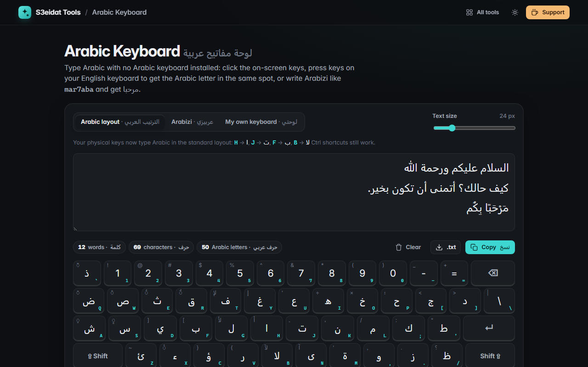

# Arabic Keyboard

> Type Arabic without an Arabic keyboard. Free, private, and it runs entirely in your browser.

### ▶ [Open Arabic Keyboard](https://s3eidat.github.io/arabic-keyboard/)



## Features

- **On-screen keyboard** in the standard Arabic (101) layout, with a **Shift layer** (hamza forms, harakat, لأ لإ لآ) that you can lock with a double-click
- **Physical-key mode**: press keys on an English keyboard and get the Arabic letter in the same position (H → ا, J → ت, B → لا). Uses the key position, so it works whatever layout your system has. Ctrl shortcuts keep working
- **Arabizi mode**: type `mar7aba, kifak?` and see مرحبا، كيفك؟ live, then press Enter to add it (best-guess transliteration: 3 = ع, 7 = ح, 2 = ء, 5 = خ, sh = ش …)
- **Harakat bar**: fatha, damma, kasra, sukun, shadda, tanween, dagger alef, tatweel and Arabic punctuation
- Big right-to-left text area with adjustable text size; Western (123) or Arabic-Indic (١٢٣) digits
- Word, character and Arabic-letter counts; copy, download as .txt, clear with undo
- "Hide phone keyboard" option so only the on-screen keys appear on a phone
- Your text and settings are kept in this browser (localStorage) so a refresh doesn't lose them

## Privacy

Your text never leaves your device. There is no server, no account, no analytics.
The page ships with a strict Content-Security-Policy (`connect-src 'self'`), so the browser
itself blocks any attempt to send data anywhere.

## Run it yourself

It's plain HTML, CSS and JavaScript with no build step:

```bash
git clone https://github.com/s3eidat/arabic-keyboard
cd arabic-keyboard
python -m http.server 8000
```

Then open http://localhost:8000.

## Support

If this saved you time, **[buy me a coffee ☕](https://s3eidat.github.io/coffee/)**. It keeps every tool free.

---

Part of **[S3eidat Tools](https://s3eidat.github.io/)**: 100+ free, private tools that run in your browser. MIT licensed.
